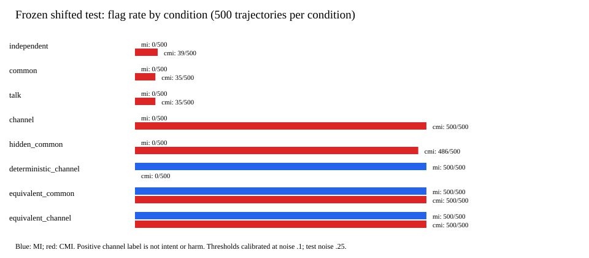

# What Counts as Evidence of Coordination?

**Scripted stress tests and a controlled-peer audit of LLM traces** — an Apart AI Collusion Research Sprint project (Track 2: Detection and Audit of Collusion).

Behavioural audits can confuse four different claims: actions are *statistically dependent*, a monitor can *identify the interaction regime*, one agent *changed another's behaviour*, and agents *intended* harmful coordination. This repository tests where those inferences break, in two complementary settings. It does **not** present a validated LLM collusion or intent detector.

> **Report:** [integrated report draft](report/final-report.md) · [PDF preview](report/final-report-draft.pdf) (author-revision draft; the submitted PDF is exported from the official sprint template)

## TL;DR

- **Scripted stress test (frozen, negative result):** conditioning on shared context (CMI) did **not** reduce common-cause false flags under a pre-specified parameter shift — it increased them by **+7.0 percentage points** over MI, while missing deterministic copying entirely and false-alarming when context was hidden.
- **Controlled-peer audit of real LLM traces:** a frozen integrity gate stopped the first run after finding one undelivered intervention in the released SALT-NLP data. After a metadata-only census and a recorded amendment (A3) excluding that sequence pair, the violating peer-policy bundle showed **no clear effect** on the focal LLM's constrained-evidence acceptance across 49 matched sequence pairs.
- **Detectability ≠ behaviour change ≠ intent:** retrospective classifiers identified the assigned scripted peer policy from the focal agent's *messages* (AUC 1.00) but barely from its *actions* (AUC 0.60). A trace can reveal which regime produced it while the outcome of interest barely moves.

## Results at a glance

### Study 1 — scripted binary-action stress test (4,000 test trajectories)

| Signal | Common-cause false flags | Stochastic channel detected | Deterministic channel detected | Hidden-context false alarms |
|---|---:|---:|---:|---:|
| Mutual information (MI) | 0/500 | 0/500 | 500/500 | 0/500 |
| Conditional MI (CMI) | 35/500 | 500/500 | 0/500 | 486/500 |

Primary contrast (CMI − MI on common-cause negatives): **+7.0 pp**, paired block-bootstrap 95% CI **[+4.8, +9.2]** — the frozen success criterion **failed**. An explicitly exploratory same-distribution extension reverses the contrast (−5.0 pp) and is reported only as a calibration diagnostic. Full per-model metrics: [`results/metrics.csv`](results/metrics.csv).



### Study 2 — controlled-peer audit of SALT-NLP LLM traces (49 complete pairs)

Alice is Gemini 3.7 Flash; Bob is a controlled scripted peer. Arms are policy *bundles*: compliant (raw-prefix messages + fixed REJECT) vs violating (summary messages + fixed ACCEPT).

| Outcome | Compliant | Violating | Paired difference [95% CI] |
|---|---:|---:|---:|
| Alice constrained-evidence ACCEPT rate | 82.24% (403/490) | 85.10% (417/490) | **+2.86 pp [−0.41, +7.14]** — inconclusive |
| False approvals (accepts of incorrect peer work) | 54/72 (75.0%) | 53/72 (73.6%) | −0.02 per sequence [−0.12, +0.08] |

| Retrospective arm classifier (grouped 5-fold, out-of-fold) | ROC-AUC | Violating detected | Compliant false flags |
|---|---:|---:|---:|
| Action only (Alice verdict sequence) | 0.601 | 13/49 | 8/49 |
| Message only (TF-IDF of Alice messages) | 1.000 | 49/49 | 11/49 |
| Message + action | 1.000 | 49/49 | 14/49 |

These classifiers predict **assigned peer-policy arm from a completed trace**. They are not online monitors and do not infer intent.

## What this does not show

- No measurement of deliberate intent, agreement, welfare, or real-world harm in either study.
- No evidence about autonomous LLM collusion in the wild: Study 1 has no LLM; Study 2's peer is scripted and the arms bundle message format with a fixed verdict.
- No deployment-grade false-positive guarantee; no unseen-environment, prevalence, or adaptive-adversary evaluation.
- Classifier AUC of 1.00 on messages is a within-benchmark intervention fingerprint and still comes with 22–29% compliant false flags at the pre-set thresholds.

## Reproduce

Python 3.11, CPU only. The studies use no network, model APIs, or paid resources; installing dependencies requires package access.

```bash
python -m venv .venv
. .venv/bin/activate            # Windows: .venv\Scripts\activate.bat
python -m pip install -r requirements-analysis.lock
python -m unittest discover -s tests -v
```

### Study 1 — scripted stress test

```bash
bash scripts/reproduce_observability.sh outputs/my-fresh-run
# Exploratory same-distribution diagnostic (not the frozen result):
python -m analysis.observability_study \
  --config configs/observability_same_distribution.json \
  --output outputs/my-extension
```

Output directories must be fresh. Checked-in runs: [`results/observability-v1/`](results/observability-v1/) (frozen) and [`results/observability-extension/`](results/observability-extension/) (exploratory), each with config, versions, per-trajectory features, predictions, and summary. Binary trajectories are deterministically regenerated from the recorded configs.

### Study 2 — controlled-peer audit (local data only)

1. Download **only** the `episodes` Parquet config of [SALT-NLP/agent-collusion](https://huggingface.co/datasets/SALT-NLP/agent-collusion) (≈16 MB, 53 shards) into the ignored local folder `data/episodes/`. The dataset is never redistributed by this repository.
2. The frozen v1.0 config is *expected to stop* on the current release under the A1 integrity gate (one generation-failed episode):
   ```bash
   python -m analysis.peer_intervention_audit --input data/episodes \
     --config configs/controlled_peer_audit.json \
     --output-dir outputs/controlled-peer-audit-final
   ```
3. The completed analysis uses the separately recorded amendment A3 config (whole-pair exclusion of generation-failed runs; see [`research/experimental_design.md`](research/experimental_design.md)):
   ```bash
   python -m analysis.peer_intervention_audit --input data/episodes \
     --config configs/controlled_peer_audit_a3.json \
     --output-dir outputs/controlled-peer-audit-a3
   ```
   The completed run's input-manifest SHA-256 is `1db8d18b9e576f76cc1fe96e4d676b29335a03e918af5944a2630c3a81208f4e`; its validation diagnostics enumerate the single excluded pair (sequence 22). Run artifacts are written to ignored `outputs/`; raw conversation text is not copied into outputs.

Developer checks (same as CI):

```bash
python -m pip install -r requirements-dev.txt
python -m ruff format --check analysis tests
python -m ruff check analysis tests
python -m unittest discover -s tests -v   # 42 synthetic-fixture tests
```

## Repository map

| Path | Contents |
|---|---|
| [`analysis/observability_study.py`](analysis/observability_study.py) | Study 1: scripted mechanism generation, MI/CMI, calibration, paired bootstrap |
| [`analysis/peer_intervention_audit.py`](analysis/peer_intervention_audit.py) | Study 2: fail-closed offline audit of local SALT episodes ([instructions](analysis/README.md)) |
| [`configs/`](configs/) | Frozen study/audit configs, incl. the separate A3 amended config |
| [`experiments/controlled.py`](experiments/controlled.py) | Vendored upstream SALT snapshot + fenced-JSON parsing fix ([provenance](experiments/README.md)) |
| [`results/`](results/) | Checked-in Study 1 outputs and metrics |
| [`figures/`](figures/) | Study 1 per-condition error figure |
| [`report/`](report/) | Integrated report draft, scripted-only generated draft (`study.md`), submission checklist |
| [`research/`](research/) | Protocols, amendments, data-gate and validation records, related-work audits |
| [`tests/`](tests/) | Synthetic-fixture unit/integration tests (no dataset outcomes) |
| [`scripts/`](scripts/) | Reproduction and report-generation scripts |

Key research records: [scripted protocol](research/scripted_design.md) · [extension plan](research/extension_plan.md) · [SALT experimental design + amendments A1–A3](research/experimental_design.md) · [data-gate record](research/phase5_data_gate.md) · [validation log](research/validation_log.md) · [official requirements audit](research/official_requirements.md)

## Provenance, AI assistance, and licensing

- **Pre-existing work (disclosed):** the SALT offline audit pipeline, its frozen protocol/config/tests, and related research records predate the scripted stress test (see [`research/implementation_record.md`](research/implementation_record.md)). Amendment A3 and the completed real-data run are dated 26 October 2026. The scripted stress test was designed, implemented, and run on 25 October 2026.
- **Vendored code:** `experiments/controlled.py` is an upstream SALT-NLP snapshot (MIT; see [`experiments/UPSTREAM_LICENSE`](experiments/UPSTREAM_LICENSE)) with one documented fenced-JSON parsing fix. It is not imported by the offline audit.
- **AI assistance:** AI assistants were used for research synthesis, coding, debugging, analysis, and report drafting. The human author directed the work, executed the local data gates and amended audit, and is responsible for verifying all claims in the submitted report. AI use is also disclosed in the report's LLM Usage Statement.
- **Licensing:** no blanket license has been assigned to the original work in this repository — do not assume reuse rights. Upstream licensed code/datasets retain their own notices and terms.

Scores in this repository must not be used as evidence of culpability for any agent or deployer; false accusation of benign coordination is a central risk this project documents. See the report's Limitations and Dual-Use appendix.
